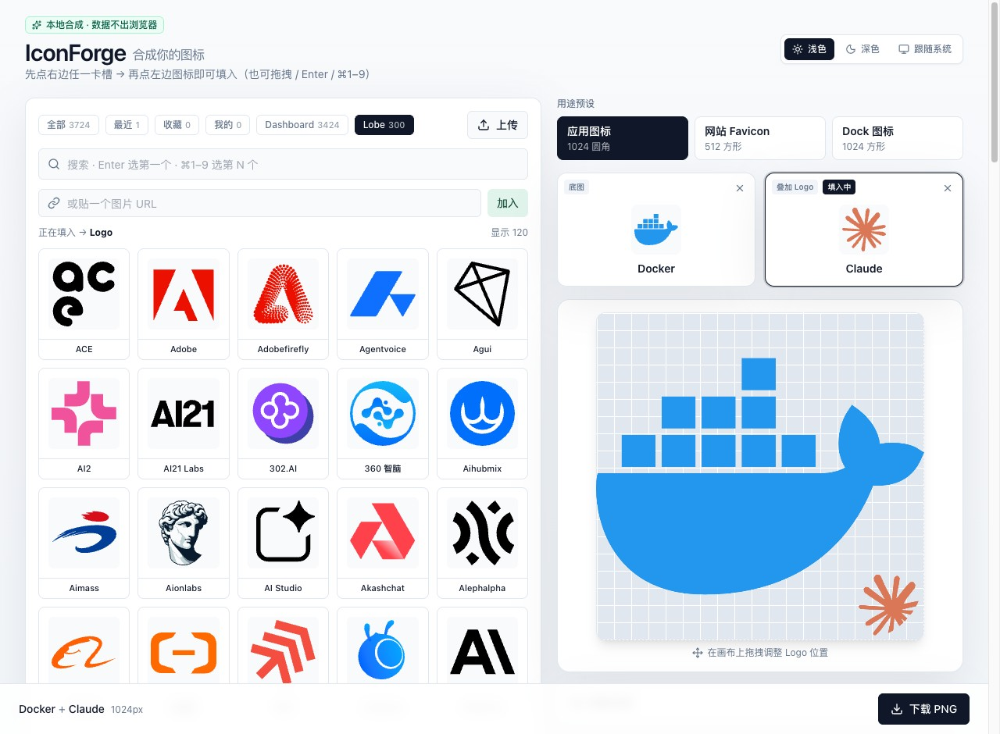
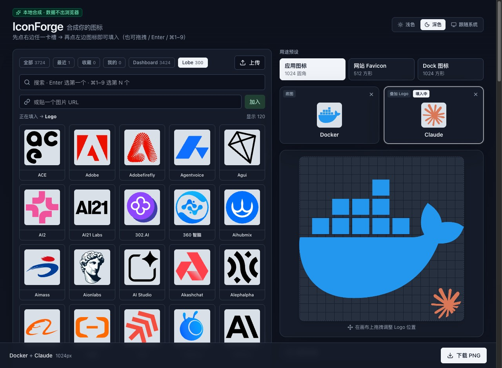
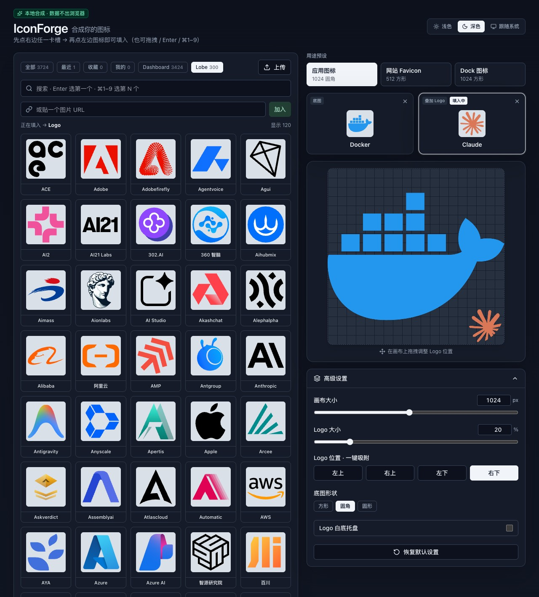

# IconForge

把「底图 + Logo」合成一张属于你的图标。浏览器内实时预览、拖拽定位，一键导出透明 PNG。

**[在线使用 →](https://iconforge.qudev.top/)** · 无需登录 · 图片本地合成 · 支持浅色 / 深色 / 跟随系统

## 界面预览

| 浅色模式 | 深色模式 |
| --- | --- |
| [](docs/screenshots/light-mode.jpg) | [](docs/screenshots/dark-mode.jpg) |

<details>
  <summary>查看深色模式的高级设置</summary>
  <p align="center">
    
  </p>
</details>

## 特性

- **两槽合成**：底图叠加 Logo，实时预览，导出 PNG；也可以只导出底图。
- **数千内置图标**：集成 [Dashboard Icons](https://github.com/homarr-labs/dashboard-icons) 与 [Lobe Icons](https://github.com/lobehub/lobe-icons)，支持名称与别名搜索；Lobe 图标优先使用彩色 SVG，无彩色版时回退到单色。
- **三种外观**：浅色、深色、跟随系统，默认跟随系统；选择自动保存，系统外观变化时实时切换。
- **直接拖拽**：把图标拖入卡槽，在画布上拖动 Logo，或一键吸附四角。
- **用途预设**：应用图标、网站 Favicon、Dock 图标，一键设置画布尺寸、形状和 Logo 比例。
- **精细调整**：128–2048 px 画布、Logo 缩放、方形 / 圆角 / 圆形底图，以及可选的 Logo 白底托盘。
- **收藏与最近使用**：常用图标快速访问，支持本地上传和图片 URL。
- **快捷选择**：搜索后按 `Enter` 选第一个，`⌘1–9` / `Ctrl+1–9` 选择前九个结果。

## 如何使用

1. 点击「底图」卡槽，在图标库中选择图标，或上传本地图片。
2. 点击「叠加 Logo」卡槽，再选择一个图标；也可直接把图标拖到对应卡槽。
3. 选择用途预设，在画布上拖动 Logo；需要更多控制时展开「高级设置」。
4. 点击底部「下载 PNG」。

在页面顶部切换外观。**跟随系统**会响应设备的深浅色设置；手动选择浅色或深色后，以你的选择为准。主题仅改变编辑界面，不会改变导出图片的颜色、背景或透明度。

设置、收藏、最近使用及图片 URL 保存在当前浏览器的 `localStorage` 中。**本地上传的文件需要在刷新后重新选择**。图片合成通过 Canvas 在本地完成，不上传图片；内置图标需要联网加载，图片 URL 还需允许跨域访问。

## 本地开发

需要 Node.js **20.19+（20.x）或 22.12+**，以及 [pnpm](https://pnpm.io/)。

```bash
pnpm install
pnpm dev        # 启动开发服务器，以终端显示的地址为准
pnpm build      # TypeScript 检查 + 生产构建，输出到 dist/
pnpm preview    # 本地预览构建产物
pnpm lint       # ESLint 检查
```

核心合成功能无需环境变量。访问统计配置见 [.env.example](.env.example)；`functions/api/stats.js` 是可选的 Cloudflare Pages 统计代理，API 密钥应放在服务端环境中。

## 技术与结构

React 19 · TypeScript · Vite 8 · Tailwind CSS · Lucide · Canvas API

```text
iconforge/
├── docs/screenshots/             # README 中的实际界面截图
├── functions/api/                # 可选的访问统计代理
├── public/                       # 网站图标等静态资源
├── src/
│   ├── components/
│   │   ├── ThemeSwitcher.tsx     # 浅色 / 深色 / 跟随系统切换
│   │   └── ui/                   # 基础 UI 组件
│   ├── lib/use-theme.ts          # 主题保存、系统监听与跨标签页同步
│   ├── App.tsx                  # 图标库与 Canvas 合成
│   ├── index.css                # 浅色 / 深色主题变量
│   └── main.tsx                 # 应用入口
└── index.html                   # 首屏主题初始化
```

## 致谢

- [homarr-labs/dashboard-icons](https://github.com/homarr-labs/dashboard-icons) — 服务与应用图标
- [lobehub/lobe-icons](https://github.com/lobehub/lobe-icons) — AI 模型与厂商图标

图标的商标与使用权归各自权利人所有，使用时请遵循来源项目的许可要求。

## License

[MIT](LICENSE)
